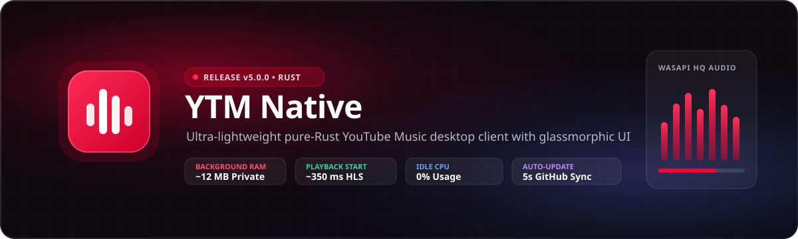
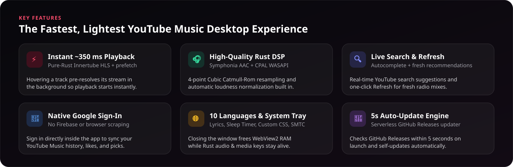

<div align="center">
  

  <br/>

  <p>
    <a href="https://github.com/Rbg4445/Ytmnative/releases/latest">
      
    </a>
    
    
    
    
    <a href="https://www.virustotal.com/gui/file/d332c2d4a3a239cee1f2785419b556d70513bac7b719555ecc29017beca692c3">
      
    </a>
  </p>

  <p>
    <strong>Electron şişkinliği olmadan, tamamen yerel Rust ses motoru ve cam efektli resmi YouTube Music tasarımıyla Windows masaüstü deneyimi.</strong>
  </p>
</div>

---

## ✨ Özellikler

<div align="center">
  
</div>

- **⚡ Anlık Oynatma (~350 ms):** Saf Rust Innertube HLS akış çözücü, kart üzerine gelince ön yükleme (*hover prefetch*) ve sıradaki 2 parçayı önceden hazırlama.
- **🔍 Canlı Arama Önerileri:** Arama kutusuna yazarken anlık YouTube tamamlama önerileri ve klavye (`↑` / `↓` / `Enter` / `Esc`) desteği.
- **↻ Akıllı Yenileme:** Üst bardaki **Yenile** tuşu (veya `F5`) her tıklamada geçmişin ve beğenilerinden farklı tohum parçalar seçerek taze öneriler getirir.
- **🎧 Yüksek Kalite Ses Motoru:** `symphonia` + `cpal` (WASAPI), 4-noktalı *Cubic Catmull-Rom* yeniden örnekleme ve ses yüksekliği normalizasyonu.
- **🪟 Sistem Tepsisi (WebView2 Bellek Temizliği):** Pencereyi kapattığında (`X`) WebView2 tamamen bellekten silinir; saf Rust ses motoru, otomatik radyo ve Windows medya tuşları (SMTC) **~12 MB Private RAM** ile arka planda çalışmaya devam eder.
- **🔐 Doğrudan Google Oturumu:** Tarayıcı çerezi veya Firebase gerektirmeden uygulama içinden güvenli Google girişi ile gerçek YouTube Music geçmişin ve beğenilerin eşlenir.
- **🌙 Ekstralar:** Şarkı sözleri (`Sözler`), Uyku Zamanlayıcısı (`🌙`), Karıştır / Tekrarla, Özel CSS, ilk açılış intro videosu ve **5 saniyede VDS'siz otomatik güncelleme**.

---

## 📊 Bellek ve Performans

<div align="center">
  
</div>

---

## 🏗️ Mimari

<div align="center">
  
</div>

---

## 🛡️ Güvenlik & VirusTotal Doğrulaması

<div align="center">
  <a href="https://www.virustotal.com/gui/file/d332c2d4a3a239cee1f2785419b556d70513bac7b719555ecc29017beca692c3">
    
  </a>
</div>

| Dosya | Windows Defender | SHA-256 | VirusTotal |
| :--- | :--- | :--- | :--- |
| `YTM-Native-Setup-1.0.0.exe` | ✅ 0 Tehdit | `d332c2d4a3a239cee1f2785419b556d70513bac7b719555ecc29017beca692c3` | [VirusTotal Raporu](https://www.virustotal.com/gui/file/d332c2d4a3a239cee1f2785419b556d70513bac7b719555ecc29017beca692c3) |
| `ytm-native.exe` | ✅ 0 Tehdit | `35299504705936268c40419122ed75dfd38b94d754b28cd49568486883d69eb8` | [VirusTotal Raporu](https://www.virustotal.com/gui/file/35299504705936268c40419122ed75dfd38b94d754b28cd49568486883d69eb8) |

---

## 📥 Kurulum

1. **[Releases](https://github.com/Rbg4445/Ytmnative/releases/latest)** sayfasından **`YTM-Native-Setup-1.0.0.exe`** dosyasını indirin.
2. Kurulum sihirbazını çalıştırın (yönetici izni gerektirmez, `%LOCALAPPDATA%\YTM Native` klasörüne kurulur).
3. Yeni bir sürüm yayınlandığında uygulama her açılışta 5 saniye içinde kontrol eder ve kendini otomatik günceller.

---

## ⌨️ Kısayollar

| Kısayol | İşlev |
| :--- | :--- |
| `Space` | Oynat / Duraklat |
| `Ctrl + K` veya `/` | Arama kutusuna odaklan |
| `F5` veya `Ctrl + R` | Yeni öneriler getir (Yenile) |
| `Ctrl + →` / `Ctrl + ←` | Sonraki / Önceki parça |
| `→` / `←` | 5 saniye ileri / geri sar |
| Medya Tuşları | Arka planda bile Windows SMTC ile tam kontrol |

---

## 🛠️ Kaynaktan Derleme

```powershell
# 1. Release ikilisini derle
cargo build --release

# 2. Windows Setup kurulum dosyasını oluştur (Inno Setup 6)
iscc installer/ytm-native.iss
```

### Yeni Sürüm Yayınlama (Otomatik CI/CD)

`Cargo.toml`, `tauri.conf.json` ve `installer/ytm-native.iss` içindeki sürümü güncelleyip etiket gönderdiğinizde GitHub Actions hem `YTM-Native-Setup-*.exe` hem de otomatik güncelleyici için `ytm-native.exe` dosyasını otomatik yayınlar:

```powershell
git tag v1.0.0
git push origin v1.0.0
```

---

## 🤝 Contributors & Acknowledgments

- **[@Rbg4445](https://github.com/Rbg4445)** — Creator & Maintainer
- **Google Antigravity** — AI-assisted Rust audio architecture, Tauri v2 desktop engineering, glassmorphic UI, and CI/CD automation
- **Claude (Anthropic)** — AI-assisted development and code assistance

---

## ⚖️ Yasal Uyarı (Disclaimer) & Lisans

- **YTM Native**, bağımsız ve resmi olmayan (unofficial) açık kaynaklı bir masaüstü istemcisidir.
- **Google LLC** veya **YouTube** ile hiçbir bağlantısı, ortaklığı veya resmi onayı bulunmamaktadır.
- "YouTube" ve "YouTube Music", Google LLC'nin tescilli ticari markalarıdır.
- Bu uygulama herhangi bir ses/müzik dosyası barındırmaz veya dağıtmaz; tüm içerikler doğrudan ilgili platformun herkese açık veya kullanıcının kendi oturumuna ait akışları üzerinden oynatılır.
- Proje [MIT Lisansı](LICENSE) altında yayınlanmıştır.

