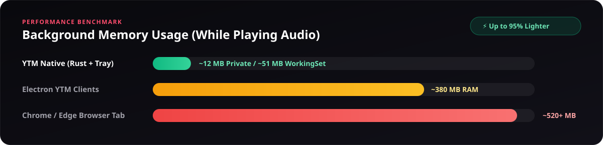
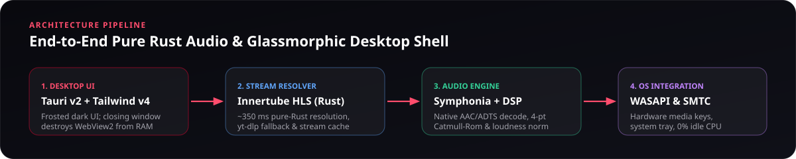
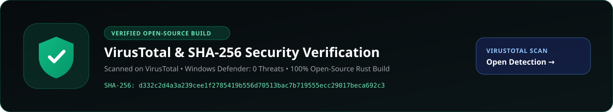

<div align="center">
  

  <br/>

  <p>
    <a href="https://github.com/Rbg4445/Ytmnative/releases/latest">
      
    </a>
    
    
    
    
    <a href="https://www.virustotal.com/gui/file/d332c2d4a3a239cee1f2785419b556d70513bac7b719555ecc29017beca692c3/detection">
      
    </a>
  </p>

  <p>
    <strong>An ultra-lightweight, pure-Rust desktop client for YouTube Music — zero Electron bloat, ~12 MB background RAM, and a frosted glass UI.</strong>
  </p>
</div>

---

## ✨ Features

<div align="center">
  
</div>

- **⚡ Instant Playback (~350 ms):** Pure-Rust Innertube HLS stream resolver, hover prefetching, and automatic next-2-tracks preloading.
- **🔍 Live Search Suggestions:** Real-time YouTube autocomplete dropdown with full keyboard navigation (`↑` / `↓` / `Enter` / `Esc`).
- **↻ Smart Refresh:** One-click **Refresh** button (`F5` / `Ctrl+R`) that rotates seed tracks from your listening history and likes to deliver genuinely fresh mixes.
- **🎧 High-Quality Rust Audio DSP:** Native `symphonia` AAC decoding + `cpal` (WASAPI) output with 4-point *Cubic Catmull-Rom* resampling and loudness normalization.
- **🪟 System Tray RAM Saver:** Closing the window (`X`) completely destroys WebView2 from memory while the pure-Rust audio engine, auto-radio, and Windows media keys (SMTC) keep running at **~12 MB Private RAM** and **0% idle CPU**.
- **🔐 Native Google Sign-In:** Sign in directly inside the app with zero Firebase or external browser cookie scraping to sync your YouTube Music history, likes, and picks.
- **🌐 Multi-Language Support (10 Languages):** Defaults to **English**, with instant switching in Settings (`English`, `Türkçe`, `Deutsch`, `Español`, `Français`, `Português`, `Русский`, `日本語`, `한국어`, `العربية`).
- **🚀 5-Second Serverless Auto-Updater:** Automatically checks GitHub Releases for up to 5 seconds on launch and self-updates seamlessly without requiring admin privileges.

---

## 📊 Memory & Performance

<div align="center">
  
</div>

---

## 🏗️ Architecture

<div align="center">
  
</div>

---

## 🛡️ Security & VirusTotal Verification

<div align="center">
  <a href="https://www.virustotal.com/gui/file/d332c2d4a3a239cee1f2785419b556d70513bac7b719555ecc29017beca692c3/detection">
    
  </a>
</div>

| File | Windows Defender | SHA-256 | VirusTotal |
| :--- | :--- | :--- | :--- |
| `YTM-Native-Setup-1.0.0.exe` | ✅ 0 Threats | `d332c2d4a3a239cee1f2785419b556d70513bac7b719555ecc29017beca692c3` | [VirusTotal Report](https://www.virustotal.com/gui/file/d332c2d4a3a239cee1f2785419b556d70513bac7b719555ecc29017beca692c3/detection) |
| `ytm-native.exe` | ✅ 0 Threats | `35299504705936268c40419122ed75dfd38b94d754b28cd49568486883d69eb8` | [VirusTotal Report](https://www.virustotal.com/gui/file/35299504705936268c40419122ed75dfd38b94d754b28cd49568486883d69eb8) |

---

## 📥 Installation

1. Download **`YTM-Native-Setup-1.0.0.exe`** from the **[Releases](https://github.com/Rbg4445/Ytmnative/releases/latest)** page.
2. Run the installer (no admin/UAC required — installs per-user into `%LOCALAPPDATA%\YTM Native`).
3. Future updates are checked automatically on startup and installed seamlessly.

---

## ⌨️ Keyboard Shortcuts

| Shortcut | Action |
| :--- | :--- |
| `Space` | Play / Pause |
| `Ctrl + K` or `/` | Focus search bar |
| `F5` or `Ctrl + R` | Refresh recommendations |
| `Ctrl + →` / `Ctrl + ←` | Next / Previous track |
| `→` / `←` | Seek forward / backward 5 seconds |
| Media Keys | Full hardware media key support via Windows SMTC |

---

## 🛠️ Building from Source

```powershell
# 1. Build release binary
cargo build --release

# 2. Build Windows Setup installer (Inno Setup 6)
iscc installer/ytm-native.iss
```

### Publishing a Release (Automated CI/CD)

Update the version in `Cargo.toml`, `tauri.conf.json`, and `installer/ytm-native.iss`, then push a tag — GitHub Actions automatically builds and publishes both `YTM-Native-Setup-*.exe` and `ytm-native.exe`:

```powershell
git tag v1.0.0
git push origin v1.0.0
```

---

## 🤝 Contributors & Acknowledgments

- **[@Rbg4445](https://github.com/Rbg4445)** — Creator & Maintainer
- **Google Antigravity** — AI-assisted Rust audio architecture, Tauri v2 desktop engineering, glassmorphic UI, and CI/CD automation
- **Claude (Anthropic)** — AI-assisted development and code assistance

---

## ⚖️ Disclaimer & License

- **YTM Native** is an independent, unofficial open-source desktop client.
- It is **not affiliated with, endorsed by, or associated with Google LLC or YouTube**.
- "YouTube" and "YouTube Music" are registered trademarks of Google LLC.
- This application does not host or distribute any audio files; all streams are played directly on the user's device from publicly available or user-authenticated sessions.
- Released under the [MIT License](LICENSE).
